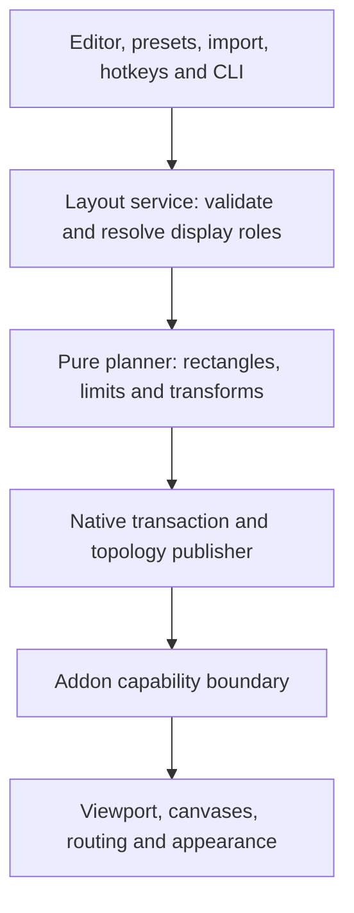

# Companion layout gap analysis and implementation plan

4 November 2026. **Approved for phased implementation, subject to the
[interaction and release boundaries](COMPANION-INTERACTION-AND-RELEASE-BOUNDARIES.md).**
Proposed capabilities below are not current runtime support. The first pure
layout-model increment and its test evidence are recorded in that boundary
document; native application and topology negotiation remain gated work.
Baseline: source `3d68a2c6558c669da99c5e7c9ecb0bbec7201e1e`, Companion
2.1.3 Beta 5 (file 2.1.3.6), unofficial Workspace Test 2. This plan extends the
[original custom-region plan](CUSTOM-WORKSPACE-REGIONS-IMPLEMENTATION-PLAN.md)
without changing the published test package or its acceptance claims.

## 1. Outcome and scope

Give Offhand a flexible, understandable layout editor and convenient layout
management while preserving its WoW-specific viewport, panel ownership,
recovery and compatibility contracts. The first substantial outcome is one
ultrawide containing a rectangular game area and two independent workspace
areas, including both sides of the game or a stacked pair on one side.

Use FancyZones as a feature reference for layout authoring and convenience.
Keep arbitrary desktop application management a separate product decision.
Offhand owns one WoW native window plus addon-managed UI destinations. It does
not turn WoW panels into independent Windows windows.

The user approved the recommended actions while explicitly requiring attention
to WoW ToS/EULA, Warden compatibility and Defender false positives. Research
spikes and acceptance gates determine which proposed capabilities can become
supported use. Approval does not waive those boundaries, establish vendor
authorization, or permit bypassing a protection. Published packages remain
immutable; further implementation proceeds in separate reviewable increments.

## 2. Evidence and current capability

The FancyZones reference is Microsoft's [current documentation](https://learn.microsoft.com/en-us/windows/powertoys/fancyzones),
reviewed on the date above. Its relevant capabilities are summarized briefly in
the reference column below. Offhand findings come from the live source at the
baseline commit, with the existing QA ledger used only for its recorded scope.

| Evidence | What it establishes |
| --- | --- |
| `Companion/Source/Program.cs`, `MonitorSelection.CreatePlan` and `CreateMultiPlan` | Single-monitor custom mode uses full-height strips. General custom mode requires distinct displays for game and each workspace and permits one or two workspaces. |
| `Core/WorkspaceRegions.lua`, `ValidateTopology` | Schema 2 independently enforces the same distinct-device rule, rectangular bounds, unique region IDs, non-overlap and allocation limits. A UI-only relaxation cannot support new layouts. |
| `SpanClipRegion` and `NativeSpanTransaction` in Program.cs | Native region union and rollback machinery already exist. Preserve them when extending the plan model. |
| `WorkspacePlanProfiles` | At most 20 native plans, version 1 serialized settings, fixed `[12]` region-field allowlist and exact saved-resolution validation. Native plans currently depend on Multiple workspaces mode. |
| `Core/WorkspaceProfiles.lua`, `WorkspaceRouting.lua`, `Canvas.lua`, `UI/WorkspaceOptions.lua` | Named addon layouts, supported panel-group routing, normalized saved placement, independent canvases and appearance exist. Manual placement takes precedence. |
| `Core/UserMedia.lua` and Studio core | A two-image library and per-region assignments exist. A larger region count must reuse assets and retain the aggregate media budget. |
| Program.cs `WndProc` and app.manifest | DPI awareness is declared. The inspected window procedure handles interactive sizing, not an explicit display/DPI transition workflow. No RegisterHotKey implementation was found in this source. This does not imply that all topology polling/recovery is absent. |
| [Test 2 QA](WORKSPACE-TEST-2-QA-20261104.md) and [Companion UX QA](COMPANION-UX-QUALITY-PASS-20261104.md) | Recorded native span/restore, image, profile and editor evidence. Physical mixed DPI, hotplug, simultaneous two-workspace rendering, combat and other listed gaps remain open. |

The shared knowledge project README and research skill were consulted and its
status and targeted geometry query were run. Retrieval returned unknown/no
exact symbol. This is a knowledge gap, not API absence. Local source governs
the project format; Microsoft references below govern the cited Windows API
contracts. New client API or protected-action decisions require a fresh,
client/build-specific study before implementation.

## 3. Gap register

Status: **Partial** means a useful equivalent already exists; **Missing** means
the inspected implementation does not provide the workflow; **Scoped out**
means it is deliberately excluded from the recommended core work. Priority P0
is a prerequisite, P1 the next feature slice, P2 subsequent convenience, P3
optional later work. Effort S/M/L is relative engineering size, not a delivery
date or a promise that native acceptance will pass.

| ID | Reference capability | Offhand gap/status | Proposed treatment | Priority / effort |
| --- | --- | --- | --- | --- |
| G01 | Multiple zones on one display | Missing independent same-monitor workspaces; the single-monitor strip is a separate legacy path. | One game plus initially two non-overlapping workspaces on the same or different displays. | P1 / L |
| G02 | Movable Canvas rectangles | Partial: rectangular offhand areas exist, but single-monitor occupied space is full-height and edge-anchored. | Allow game/workspace rectangles within a display; allow top/bottom offsets and desktop gaps, subject to renderer tests. | P1 / L |
| G03 | Split/merge Grid editor | Missing. | Optional grid authoring compiles to the same validated rectangular plan as freeform editing. | P2 / M |
| G04 | Relative Grid sizing | Missing proportional geometry; resolution changes require review. | Explicit Fixed pixels or Proportional sizing, deterministic rounding and preview before changed geometry applies. | P2 / M |
| G05 | Templates | Partial: ordinary spanning and equal split exist. | Add ultrawide and multi-display presets, then customize through one editor. | P1 / M |
| G06 | Visual layout selection | Partial: chooser, preview, overlays and numeric controls exist in separate modes. | Unified monitor map, selected region inspector, roles, snapping guides, zoom and clear draft/applied state. | P1 / L |
| G07 | Keyboard editing | Partial: overlays support arrows, fine movement, resizing and cancel. | Complete focus order, accessible names, shortcuts, undo/redo, duplicate/delete safeguards and high-contrast testing. | P1 / M |
| G08 | Gaps and overlay appearance | Partial: region themes/images exist; editor controls are more limited. | Show deliberate desktop gaps, numbered region outlines and configurable editor contrast. Preserve exact pixel semantics. | P2 / S |
| G09 | Layout switching hotkeys | Missing native global layout shortcuts. | Configurable opt-in hotkeys, conflict detection, tray picker and explicit reload/apply status. | P2 / M |
| G10 | Layout cycling while dragging | Missing. | Consider cycling saved candidates in the Companion editor. Do not intercept all desktop drags or WoW gameplay input. | P3 / M |
| G11 | Cross-monitor zones | Missing zones that individually cross display boundaries. | Later research only; start with each authored rectangle contained in one monitor. | P3 / L |
| G12 | Overlapping Canvas zones | Active Offhand regions reject overlap. | Keep rejection for the first releases. Stacked panels within a workspace remain possible; overlapping active regions need a separate ownership design. | Scoped out initially |
| G13 | Resolution/layout adaptation | Partial: stable identities and validation exist, but saved resolution mismatch refuses loading. | Opt-in proportional adaptation, impact preview and explicit rebind for missing/ambiguous displays. | P2 / L |
| G14 | Remember application destinations | Partial equivalent: supported WoW panel routing and saved manual placement already exist. | Improve discoverability, missing-destination UI and panel fit previews; preserve manual ownership. | P2 / M |
| G15 | Span a window across zones | Missing equivalent command for WoW panels. | Research adjacent-region fitting for eligible panels; start with move-to-region, native size and return-to-Mainhand. | P3 / L |
| G16 | Cycle windows within a zone | Missing dedicated panel cycling. | Optional addon action for a known panel registry, with protected-action and combat checks. | P3 / M |
| G17 | Share custom layouts | Missing supported plan import/export. | Bounded declarative JSON, logical display roles, preview/rebind and copy import; no executable content. | P2 / M |
| G18 | Command-line layout control | Missing a public layout CLI. | List, inspect, validate, export/import, select and restore through the same service as the GUI. Apply remains compatibility-gated. | P3 / M |
| G19 | Unsnap/restoration behavior | Partial: exact native Restore Window and transaction rollback already exist. | Preserve baseline snapshots; add editor undo and narrowly scoped last-applied-layout rollback with clear ownership. | P0 / M |
| G20 | Automatic new-window placement | Partial equivalent only for supported WoW panels; external apps unmanaged. | Extend through capability-checked addon adapters, never indiscriminate frame enumeration. | P2 / M |
| G21 | Application exclusions | Partial equivalent: addon compatibility/yield rules exist. | Expose relevant panel exclusions and document complementary use with desktop tools. | P2 / S |
| G22 | Monitor rotation / general window snapping | Desktop app management, popup/child windows and elevation are outside current Companion ownership. | Prefer documented coexistence with FancyZones. A desktop-window manager would be a separately approved feature track. | Scoped out |
| G23 | Virtual-desktop-aware layouts | Missing automatic plan association with Windows virtual desktops. | Optional research after lifecycle safety; use documented APIs, keep explicit selection as fallback, and do not move WoW between desktops automatically. | P3 / L |

More than two workspaces is an additional capacity gap. Keep two for the first
new-model release, then evaluate a bounded increase, initially four, after
performance, routing, persistence and editor testing. Do not equate zone count
with image count or silently remove renderer guardrails.

## 4. Restrictions and design decisions

### 4.1 One native window, one rectangular game view

WoW remains one native window spanning the bounding rectangle of the selected
game/workspace rectangles. The addon constrains the WorldFrame viewport and
creates workspace canvases. Native clipping controls which portions of that
window Windows displays. It does not create independent game windows or prove
that hidden pixels have no GPU, compositor or allocation cost.

Windows [SetWindowRgn](https://learn.microsoft.com/en-us/windows/win32/api/winuser/nf-winuser-setwindowrgn)
uses window-relative coordinates and transfers region-handle ownership after
success. Keep correct border/client offsets, handle lifetimes and native
rollback. Test mouse input and desktop access in excluded gaps independently
from screenshot appearance. Native game screenshots can include clipped-out
parts of the backing surface.

The game view remains one axis-aligned rectangle. Non-rectangular game views,
multiple independent camera views and separate OS windows for bags/maps are
outside this architecture. Active game/workspace overlap remains rejected.
Potential overlap support is a design choice requiring new hit-testing and
ownership rules, not a general claim that Windows cannot overlap windows.

### 4.2 Coordinate and rendering budget

Store authored rectangles in monitor-local physical pixels, with stable display
identity plus optional logical role and proportional intent. Resolve to absolute
desktop coordinates, calculate the native window bounds/region, then explicitly
convert to the bridge's bottom-left physical coordinates and UIParent units.
Do not mix top-left editor coordinates with addon placement coordinates.

Start with current schema 2 limits: maximum bounding axes 16384, bounding area
no more than four times game area, game at least 960x600 and each workspace at
least 480x600. Schema 1 legacy paths have different historical bounds; preserve
them rather than silently reducing existing support. Changes to any limit need
separate measured justification. A panel can still be too large for a valid
workspace; preserve native-size Mainhand fallback and warn about fit/readability.

Clipping is not a performance guarantee. Compare frame time, memory and
rendering behavior against ordinary windowed and existing span modes on the
same client/settings. Use the actual bounding surface and read-only diagnostics;
do not present the saved gxWindowedResolution value as a measured backbuffer.

### 4.3 Compatibility and publication

Recommend a separately negotiated **topology schema 3** for layouts that schema
2 intentionally rejects. Preserve old schema 1/2 readers, emitters and
validation semantics. Add a new advertised capability and Companion minimum
where required; do not repurpose the existing two-region schema 2 contract.
This number is unrelated to User Media schema 3.

Older addons must refuse an unsupported plan before native resize. New addons
continue to accept old bridges. Future or malformed persisted data is preserved
and refused, never silently downgraded or rewritten. Test every skew pairing.
Do not expand the Companion protocol number unless the compatibility study
shows that topology-capability negotiation is insufficient.

Keep current portable/Store/Wine considerations explicit. A Windows API feature
may need a manual fallback in another distribution/runtime. Publish native
candidates through the existing candidate workflow. Public frozen binaries and
Test 2 remain immutable snapshots.

### 4.4 Protected UI and synchronization

Known panel adapters and native ownership rules remain authoritative. Do not
move arbitrary protected descendants, bypass combat lockdown, overwrite Blizzard
Edit Mode layouts during login, or fight replacement addons. Queue only
eligible, generation-checked work and revalidate it after combat.

The current Companion-to-addon bridge is a generated file. The addon may require
a reload to read changed topology. SavedVariables on disk are not a fresh live
acknowledgement or a reliable current combat signal. A profile-selection hotkey
must not imply that native window and addon layout have switched together.

Use states such as Draft, Saved, Native applied, Reload needed and Addon accepted
only when evidence supports them. Initially hotkeys select a plan or open its
apply UI. Automatic or supposedly immediate synchronized application is gated
on a proven live acknowledgement design. No injected slash commands, game input,
process injection or unsupported IPC to hide this limitation.

### 4.5 DPI, display changes, taskbar and global shortcuts

Declared PerMonitorV2 awareness is not physical mixed-DPI acceptance. Windows
[WM_DPICHANGED](https://learn.microsoft.com/en-us/windows/win32/hidpi/wm-dpichanged)
and [WM_DISPLAYCHANGE](https://learn.microsoft.com/en-us/windows/win32/gdi/wm-displaychange)
are relevant inputs, not a complete monitor-disconnection solution. Re-enumerate
stable display identity and test sleep, resume, docking and remote-session
changes separately. Do not change the user's Windows display arrangement,
scaling, HDR, taskbar settings or installed drivers to make a layout work.

Preserve the current fullscreen taskbar behavior within WoW-owned areas and
desktop access elsewhere. Avoid globally hiding Explorer's taskbars or keeping
unrelated windows permanently underneath WoW. Test focus changes and normal exit.

Use [RegisterHotKey](https://learn.microsoft.com/en-us/windows/win32/api/winuser/nf-winuser-registerhotkey)
with configurable opt-in bindings and registration-error handling. Windows-key
combinations are reserved by Windows; do not promise the FancyZones keybindings
will be available. Avoid overriding Windows Snap or WoW gameplay bindings by
default. Always retain tray, menu and ordinary Restore Window access.

### 4.6 Sharing and external tools

Share geometry, logical display roles and safe appearance references. Exclude
account paths, credentials, recovery snapshots, process handles, logs,
SavedVariables and embedded executable media. Imported monitor bindings require
local review. Image IDs can be missing; retain them and use the established
theme fallback. Images remain a separate optional User Media package.

FancyZones and Offhand must not compete over the same WoW window. Document
ownership and test coexistence before claiming integration. Do not write
PowerToys' private settings files automatically. Its documented CLI could be
an optional future adapter after detection, compatibility and user-action review.

The upstream [FancyZones work-area design](https://github.com/microsoft/PowerToys/blob/main/doc/specs/FancyZones-DCR.md)
includes monitor and virtual-desktop identity. Treat that design document as
source evidence, not proof that every released transition is bug-free. Windows
[IVirtualDesktopManager](https://learn.microsoft.com/en-us/windows/win32/api/shobjidl_core/nn-shobjidl_core-ivirtualdesktopmanager)
exposes documented window/desktop operations; it does not by itself establish
a complete reliable desktop-switch notification workflow. Research any proposed
association without private shell interfaces, registry timing assumptions or
automatic movement of the player's WoW window to another desktop.

The PowerToys repository uses the [MIT license](https://github.com/microsoft/PowerToys/blob/main/LICENSE).
Conceptual inspiration does not require importing its code. If implementation
copies source, review the exact files, dependencies and notices first. No source
has been copied as part of this plan.

## 5. Proposed architecture

Introduce a versioned internal LayoutDocument and a pure planner before changing
native behavior. Split responsibilities from the large Program.cs in small,
characterized steps, rather than combining a rewrite with feature development.

Proposed document fields: format version; layout ID/name; logical monitor roles
and optional local bindings; one game rectangle; bounded workspace records with
stable IDs, role, sizing policy and rectangle; primary workspace ID; editor-only
guides/gaps; optional addon-layout association. Pixels remain the final applied
authority. Proportions describe intent and compile deterministically.

Windows snapshot/recovery data stays separate from shareable documents. Grid
cells and templates are authoring tools that produce ordinary rectangles. Both
grid and canvas use the same validator, undo stack and preview renderer.

Use one layout service for GUI, import, CLI and shortcuts. Save performs no native
resize. Apply preflights client identity, addon capability, monitor resolution,
geometry budget and all output paths, then uses the existing rollback-capable
native operation. Separate atomic file replacement from coordinated application;
several files plus a window mutation are not one atomic filesystem transaction.
Define rollback/recovery receipts and interrupted-apply handling explicitly.

Stable region IDs survive move, resize and rename, keeping routing, panel
positions and image assignments attached. Region deletion retains recoverable
orphaned intent and offers an explicit reassignment; no silent nearest-region
substitution. The primary-region aliases continue to support older adapters.

## 6. Delivery sequence

### Phase 0: acceptance baseline and feasibility spikes, P0

Keep Test 2 unchanged. Audit the remaining QA gates and record exact supported
client/build and distribution scope. Characterize all existing modes and profile
serialization before extraction. Decide the proposed topology capability after
reviewing both readers and generated bridge validation.

Prototype the new pure planner with same-display rectangles only in fixtures.
Run a private, reversible native spike for center-game/side-workspaces and for
a desktop gap, with actual input/focus checks. Verify native viewport, HUD/panel
fit, popup containment, taskbar behavior, frame-time impact and exact Restore.
No permanent settings migration or auto-apply in this spike.

**Exit:** measured evidence supports the rectangle approach, unresolved client
limits are named, and rollback/malformed-layout checks pass. Failed native
viewport/input behavior blocks the affected layout, not every unrelated editor
improvement. No claim of physical multi-monitor acceptance from fixtures.

### Phase 1: unified model and migration, P0/P1, large

1. Extract pure layout data/validation/transform services with characterization
   tests; preserve existing native behavior and packages.
2. Add LayoutDocument and legacy adapters for equal split, single strip,
   secondary area and schema 2 multiple workspaces.
3. Add new topology-capability validation in Companion and addon behind an
   opt-in feature gate. Permit repeated references to a valid monitor only in
   the new schema; retain unique region IDs and non-overlap.
4. Migrate native profile storage by copy into a new versioned store or key.
   Do not extend the old `[12]` allowlist in place and lose downgrade data.
5. Keep addon placement/theme/image ID records intact. Audit schema-number
   assumptions and singular-workspace aliases across every adapter.

**Exit:** old plans produce the same rectangles and restore behavior; old
preferences remain recoverable; new/old/missing/malformed/future reader pairs
behave explicitly. This phase is not permission to expand every geometry limit.

### Phase 2: useful single-ultrawide layouts, P1, large

Ship initially one game plus at most two workspaces. Each rectangle fits wholly
within a connected display. Support two workspaces on one display, a game
rectangle within that same display, and deliberate free desktop areas.

Starter scenarios:

| Scenario | Concrete example / intended result |
| --- | --- |
| Center game, two sides | 5120x1440: workspace-a 1280x1440, game 2560x1440, workspace-b 1280x1440. |
| Two stacked workspaces beside game | 3440x1440: game 2560x1440 and a side column split into two 880x720 workspaces. |
| Existing partial strip | 5120x1440: workspace 1280x1440 plus game 2560x1440, leaving 1280x1440 desktop. |
| Offset area / desktop gap | Keep the game and workspace rectangular while exposing an explicitly previewed desktop area outside their native union. |
| Existing two/three-display plans | Preserve each established mode and its routing/restore behavior. |

Wire these through viewport, canvases, routing, profile association and existing
Themes/Studio image assignments. Workspace count and media capacity remain
independent. Eligible large panels keep native-size Mainhand recovery.

**Exit:** native rendering and input agree with the editor, gap clicks reach
the desktop, no hidden region captures ordinary desktop actions, both sides of
the game remain usable, reload/cold login/profile switching preserve IDs, and
exact window restore survives normal exit and injected failure cases.

### Phase 3: unified editor, presets and proportional layouts, P1/P2, large

Use a scaled monitor canvas plus selected-region inspector for all modes. Keep
simple presets as the first step and advanced region editing optional. Provide
game/workspace/desktop role labels, selected and applied states, monitor names,
pixel readouts, alignment/snap guides, optional gaps, aspect lock and a clear
fit warning. Drag previews update a draft only, not the running WoW window.

Add undo/redo and cancel, keyboard move/resize with fine steps, meaningful
screen-reader names, translated-text expansion, high contrast and monitor DPI
changes. Keep numeric entry as an equal input method. Add grid split/merge
using the same planner. Merging preserves one chosen region ID and explicitly
handles the retired region's assignments; splitting creates a new ID and clear
initial appearance inheritance.

Offer Fixed pixels and Proportional sizing. Quantize shared grid edges together
to prevent one-pixel seams or overlaps. At a new resolution, show a proposed
adaptation and panel-fit warnings before replacing applied geometry.

**Exit:** an unfamiliar tester can create all Phase 2 scenarios without editing
an INI, cancel without mutation, recover an invalid edit, and complete the
workflow with keyboard-only input at 100/125/150/200% editor scale.

### Phase 4: plan convenience, portability and commands, P2/P3, medium

Enable named plans consistently across every layout mode. Add a tray picker,
layout descriptions/preview and opt-in conflict-checked hotkeys. Initially
selection and application remain distinguishable, with reload-needed status.
Retain no-hotkey and manual paths.

Add import/export with a proposed 64 KiB file bound, bounded depth/counts and
strict declarative fields. Use portable display roles by default, optional
local bindings, duplicate-ID handling and preview before adopting an import.
Unknown versions remain untouched. Import creates a copy until explicitly saved.

Add CLI read/validate commands first, then select/import/export/restore through
the layout service. Any future apply command has the same checks and visible
pending-addon state as the GUI. Distribute only through supported package entry
points; do not assume Store and portable CLI launching work identically.

**Exit:** repeated selection is idempotent, failed hotkey registration leaves
controls usable, imported plans cannot execute code or bind silently to the
wrong monitor, and GUI/CLI compilation yields identical rectangles.

### Phase 5: panel placement experience, P2/P3, medium to large

Improve existing opt-in routing with readable destination names, an explicit
manual-versus-rule indicator, missing-region recovery and panel-size warnings.
Expose move to workspace/Mainhand and reset-to-routing through supported
addon-owned controls. Persist destination intent through region resize/switch.

Research panel cycling and fitting across adjacent workspaces separately.
Union-to-rectangle fitting may cross a game area, desktop gap or unsupported
frame ownership boundary; reject those cases. Enable only named, tested panel
adapters and honor hardware/combat rules. Bags, chat, interaction windows and
third-party panels retain their dedicated existing contracts.

**Exit:** repeated show/hide, manual placement, layout changes and combat
transitions preserve ownership and do not accumulate hooks or recurring scans.
Native protected descendant actions and replacement addons require live tests.

### Phase 6: topology lifecycle, synchronization and capacity, P2/P3, large

Add debounced display/DPI/resume invalidation and cancel stale pending applies
using generation IDs. Re-enumerate monitor identity and resolution, classify
exact restoration versus proposed adaptation, and preserve the last valid plan.
Disconnected, duplicate-identity and ambiguous replacement monitors require
explicit recovery/rebinding. Do not silently choose a similar screen.

Initially notify and offer safe recovery. Add opt-in auto-apply or instant native
profile switching only after a supported, fresh addon acknowledgement and combat
deferral design has passed client-specific review. If that communication cannot
be established, retain manual Apply plus reload; the limitation remains visible.

Evaluate four workspaces only after two-region stability, measured rendering
budget and adapter audits. Investigate individually cross-monitor rectangles
after mixed-DPI and rotation evidence. Arbitrary overlapping active regions and
general desktop-window rotation remain outside the first supported milestone.

**Exit:** physical disconnect/reconnect, sleep/resume, resolution/DPI changes,
remote-session transitions and interrupted applies recover without moving user
windows unexpectedly or losing saved plans. Unsupported environments degrade
to the documented manual path.

Virtual desktop associations are an optional later spike after those lifecycle
checks. Explicit user selection remains valid even if a reliable supported
notification mechanism cannot be established.

## 7. Work packages and source routing

| Package | Main areas | Depends on | Required evidence |
| --- | --- | --- | --- |
| WP0 characterize baseline | Existing native fixtures, Lua suites, Test 2 QA | None | Exact source/build receipts and unchanged old outputs |
| WP1 planner/data extraction | Program.cs MonitorSelection, profile allowlist, proposed small layout-service files | WP0 | Pure geometry, fixed/proportional transforms, serialization/downgrade |
| WP2 topology negotiation | CompanionTopologyBridge, six TOCs, Core/WorkspaceRegions.lua, Core/Viewport.lua | WP1 | Schema 1/2 compatibility and new-schema rejection/skew fixtures |
| WP3 renderer/ownership | SpanClipRegion, NativeSpanTransaction, Canvas, Mainhand geometry, panel placement | WP2 | Native pixels/input/focus/taskbar, rollback, client viewport and protected ownership |
| WP4 editor/presets | Current chooser, PartialSpanDialog, SecondaryAreaDialog, WorkspaceRegionsDialog, overlays, CompanionUi | WP1; WP3 before enabling new Apply | Draft/cancel/undo, keyboard, DPI, accessibility and novice task completion |
| WP5 profile/portability tools | WorkspacePlanProfiles, native app entry point, new import/export/hotkey adapters | WP1/WP4; WP2 for new layouts | Same validation from every entry point, bounded untrusted-data checks |
| WP6 addon placement UI | WorkspaceProfiles/Routing, WorkspaceOptions, Canvas adapters, locales | WP2/WP3 | Manual precedence, missing IDs, fit and supported client lifecycle |
| WP7 lifecycle/automation | Display polling, WndProc/message handling, native transaction, future acknowledgement design | WP3/WP5/WP6 | Real hardware and fresh-state safety; no stale SavedVariables assumption |
| WP8 promotion | Candidate builder, package allowlists, docs and compatibility metadata | Accepted relevant packages | Exact packaged artifact and rollback matrix, separate unofficial tag |

Do not combine all packages in one review. Suggested first reviews: (1)
characterization/extraction with unchanged behavior, (2) new schema and migration
behind a gate, (3) same-monitor two-region vertical layouts and native evidence,
(4) editor/presets and user workflow, then convenience and broader layouts.

## 8. Acceptance and release gates

| Area | Minimum cases |
| --- | --- |
| Geometry | One ultrawide; two workspaces on one monitor; centered game; stacked regions; free gaps; portrait/landscape/offset/negative desktop coordinates; boundary and integer overflow cases. |
| Plans | Fixed/proportional sizing; same monitor re-enumerated; changed resolution; missing/duplicate identity; deleted/renamed region; primary change; legacy and future stores; no lost old settings. |
| Compatibility | Old/new Companion and addon pairs, absent capability, schema 1/2 unchanged, new schema explicitly accepted/rejected, Lua 5.1 and all six TOCs. |
| Native ownership | Style/bounds/region/foreground/taskbar/input before and after span/restore; Alt-Tab; desktop gap clicks; repeated apply; normal shutdown; failures at each mutation boundary; stale PID/window-handle recovery. |
| Client behavior | Recorded Retail and Anniversary builds first; exact applicable Forever, Era, Classic and legacy branches separately. Load, reload, cold relaunch and native panel recovery. A mock pass does not promote a client. |
| Protected panels | Supported panels and actual descendant actions before/during/after combat; fresh taint/error comparison; replacement addon ownership and unsupported panel exclusions. |
| Studio/appearance | Same asset across several regions; two different assets; per-region fit; missing asset; renamed/resized/deleted region; profile restore; aggregate texture budget unchanged. |
| UX | Keyboard-only editing; 100/125/150/200% scale; mixed physical DPI; localized expansion; high contrast/screen reader; draft versus applied status; reachable restore; unfamiliar tester completes a preset and a custom layout. |
| Lifecycle | Disconnect/reconnect, docking, sleep/resume, rotation, resolution/scaling changes and remote-session transitions; callbacks from old generations cannot reapply a stale plan. |
| Cost and packaging | Measured frame time/allocation against baseline, bounded event work, no idle frame-tree scanning, x64/x86 fixtures, native candidate provenance, source/ZIP hashes, inert bridges and private-state exclusions. |

Run the existing 90 Lua suites and relevant native fixtures when runtime changes
begin. Add new tests for semantic geometry, migration, ownership and failure
boundaries. Documentation preparation itself does not establish any new runtime
pass. Keep static, simulation, native visible behavior, physical hardware and
protected-action acceptance distinct in each candidate's evidence ledger.

The first useful follow-up test package should stop after Phases 0-3: safe
same-monitor multi-region layouts, unified editor and presets with backward
compatibility. Shipping every convenience feature together would make failures
harder to isolate. Each later slice gets its own acceptance and unofficial
package before intentional official-release promotion.

## 9. Recommended starting decisions and open questions

Recommended defaults that do not require user prompts: retain manual application;
start at two workspaces; preserve one rectangular game view; reject active
overlap; keep geometry limits and media budgets; offer fixed pixels by default;
preserve old plans; keep desktop-window management external; make keyboard and
numeric access first-class.

Resolve these with source studies and bounded prototypes before dependent work:

- Can all initially targeted clients keep a centered/vertically offset game
  viewport, native panel recovery and popup/HUD placement coherent?
- Does clipping provide correct desktop input/focus for internal gaps on each
  supported Windows/client/display configuration, including taskbar edges?
- What performance cost follows the bounding surface versus visible regions?
- Can a supported mechanism supply fresh topology acceptance and combat state
  without injection or synthetic game input? If not, manual reload remains.
- Which display/DPI events and runtime APIs are dependable in portable, Store
  and Wine builds, and which features need manual fallback?
- What bounded region count is justified after real measurements? More than
  two is a later capacity decision, not a prerequisite to same-monitor support.

The implementation order answers those questions before expanding public
promises. No physical-test or policy limitation is assumed solved by this plan.
